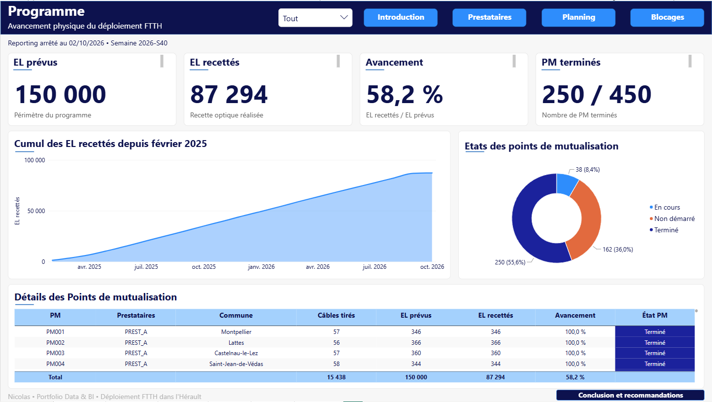
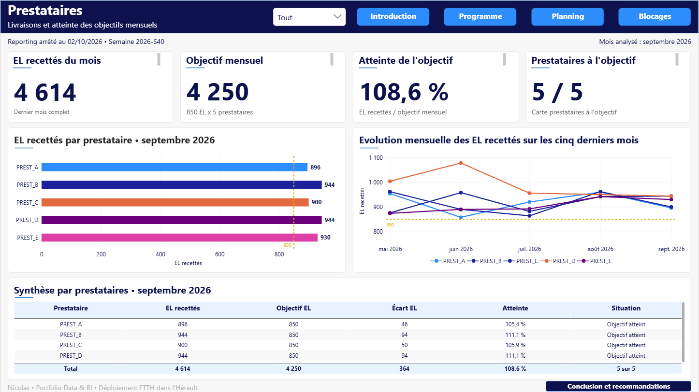

# Pilotage du déploiement FTTH dans l’Hérault

**Portfolio Data Analyst · BigQuery SQL · Python · Power BI**

Comment transformer des suivis de travaux en indicateurs utiles pour piloter un déploiement fibre ?

Dans ce projet, j’analyse des données opérationnelles **100 % synthétiques** pour suivre l’avancement physique du réseau, comparer les prestataires et examiner les écarts de planning ainsi que les blocages. Je m’appuie sur une logique de suivi terrain : contrôler les données, définir les règles métier, puis construire un rapport lisible et vérifiable.

Le reporting est figé au **vendredi 2 octobre 2026, semaine 2026-S40**.

**Accès aux livrables :** [rapport PDF](power%20bi/portfolio%20d%C3%A9ploiement%20FTTH.pdf) · [fichier Power BI](power%20bi/portfolio%20d%C3%A9ploiement%20FTTH.pbix) · [notebook Python](python/controle_exploration_ftth.ipynb) · [requêtes SQL](sql/)

## Résultats clés et enseignements

| Axe | Résultat observé | Ce que j’en retiens |
| --- | --- | --- |
| Programme | **87 294 EL recettés sur 150 000**, soit **58,2 %**. **250 PM terminés sur 450**. | Les PM en cours constituent un point d’attention pour identifier ceux qui peuvent être achevés en priorité. Sans trajectoire prévisionnelle globale, ce taux ne permet pas de conclure à une avance ou à un retard du programme. |
| Prestataires | En septembre 2026, **4 614 EL recettés** pour un objectif collectif de **4 250**, soit **108,6 %**. Les **5 prestataires sur 5** dépassent leur objectif individuel de 850 EL. | Le résultat mensuel est positif. L’évolution d’un mois à l’autre reste nécessaire pour apprécier la régularité des livraisons. |
| Planning | Sur **S37 à S40**, **2 336 opérations tenues sur 3 647 échues**, soit **64,1 %**. La fiabilité passe de **69,3 % à S+1** à **59,8 % à S+3**. | Atteindre l’objectif mensuel ne signifie pas tenir tous les engagements hebdomadaires. Une revue des opérations décalées aide à mieux préparer les semaines suivantes. |
| Blocages | **209 éléments bloqués**, dont **4 depuis plus de 30 jours**. Les premières causes recensées sont les conventions non obtenues, les écarts plan/terrain et la coactivité chantier. | Je propose d’examiner les blocages qui durent et ceux qui freinent les travaux, avec les prestataires concernés. |

Ces constats décrivent le scénario synthétique de ce portfolio. Ils ne mesurent pas les performances d’entreprises réelles.

## Questions métier

1. **Où en est physiquement le déploiement ?** Suivre les EL recettés et l’état des points de mutualisation.
2. **Les prestataires tiennent-ils leurs objectifs mensuels ?** Comparer leurs livraisons au même objectif, sur un mois complet.
3. **Quels écarts et obstacles faut-il examiner ?** Mesurer la tenue des engagements de planning et analyser les causes ainsi que l’ancienneté des blocages.

## Périmètre et données

| Élément | Périmètre retenu |
| --- | --- |
| Territoire | Hérault : communes réelles, notamment Montpellier et ses environs, avec des adresses fictives |
| Programme | 150 000 équivalents logements (EL), 450 points de mutualisation (PM), 5 prestataires |
| Calendrier | Programme démarré en février 2025, sur une durée cible de 3 ans |
| Date de référence | 2 octobre 2026, semaine 2026-S40 |
| Objectif mensuel | 850 EL recettés par prestataire, soit 4 250 EL pour les cinq prestataires |
| Dernier mois complet | Septembre 2026. Octobre est partiel et n’est pas comparé à un objectif de mois complet |
| Suivis analysés | `suivi_cables.csv` et `suivi_boites.csv`, avec 25 033 lignes chacun |

Le dossier [`data/`](data/) contient également `ftth_cables.csv` et `ftth_boites.csv`, qui décrivent le référentiel du programme à construire. **Les analyses SQL et Python reposent uniquement sur les deux fichiers de suivi.**

Les étapes distinguées sont le **tirage des câbles**, la **pose des boîtes**, la **réflectométrie** et la **recette optique**. Le projet porte sur la construction physique du réseau, sans données financières, commerciales ou d’abonnés.

### Principales règles métier

- **EL recetté :** EL associé à une boîte dont la recette optique est réalisée. Il ne s’agit pas d’un abonnement commercial.
- **PM terminé :** tous les câbles du PM sont tirés et toutes ses boîtes sont recettées. Un avancement de 100 % des EL ne suffit donc pas, à lui seul, à déclarer le PM terminé.
- **Opération échue :** le vendredi de la semaine initialement annoncée est atteint à la date du reporting.
- **Planning tenu :** l’opération est réalisée dans la semaine initialement annoncée. Les réalisations en avance sont distinguées et ne sont pas comptées comme tenues selon cette définition stricte.
- **Fiabilité :** nombre d’opérations tenues divisé par le nombre d’opérations échues, à période, prestataire et horizon identiques. Le total est recalculé à partir des volumes, sans moyenner les pourcentages.
- **Blocage actif :** blocage détecté au plus tard au reporting et non clôturé à cette date.
- **Taux de blocage :** éléments bloqués divisés par les éléments actifs non terminés, commencés ou programmés. Les câbles et les boîtes sont identifiés séparément.

La planification est déclarée par les prestataires, qui organisent leurs équipes internes et/ou leurs sous-traitants. Les horizons suivis sont **S+1, S+2 et S+3**.

## Démarche et outils

J’ai construit le projet dans l’ordre **SQL, puis Python, puis Power BI**.

### 1. BigQuery SQL : contrôler et structurer

Je contrôle les volumes, les identifiants, les doublons, la relation entre les câbles et les boîtes, la chronologie des travaux et les métrages. Je prépare ensuite les vues nécessaires aux analyses.

Les tables importées sont conservées dans `portfolio_deploiement_ftth_raw`. Les vues d’analyse sont créées dans `portfolio_deploiement_ftth`.

| Fichier | Rôle |
| --- | --- |
| [01_controles_sources.sql](sql/01_controles_sources.sql) | Vérifier les deux suivis avant de construire les indicateurs |
| [02_vues_programme_prestataires.sql](sql/02_vues_programme_prestataires.sql) | Préparer les vues câbles, boîtes, PM, prestataires et production mensuelle |
| [03_vues_controles_planning.sql](sql/03_vues_controles_planning.sql) | Regrouper les opérations, convertir les semaines ISO et calculer les indicateurs de planning |
| [04_vues_controles_blocages.sql](sql/04_vues_controles_blocages.sql) | Réunir les éléments et contrôler les blocages actifs |
| [05_analyses_validation.sql](sql/05_analyses_validation.sql) | Examiner les KPI, les derniers mois, les blocages et les longueurs tirées |

J’utilise des alias lisibles, des jointures, des agrégations, des conditions et deux requêtes avec CTE. Une fonction de fenêtre permet de calculer le cumul des EL recettés. Les commentaires expliquent ma démarche.

### 2. Python : vérifier et explorer

Dans le [notebook](python/controle_exploration_ftth.ipynb), j’utilise **pandas** et **Plotly Express** pour convertir les dates, contrôler les suivis et explorer plusieurs résultats :

- volumes, identifiants et cohérence des dates après jointure ;
- production mensuelle et cumul des EL recettés ;
- comparaison des prestataires à l’objectif de septembre ;
- évolution des câbles tirés et comparaison des longueurs réelles et cartographiques ;
- causes et ancienneté des blocages des boîtes.

L’exploration des câbles tirés apporte un regard complémentaire sur les travaux réalisés. Je ne l’ai pas retenue comme graphique principal dans Power BI, afin de concentrer le rapport sur les questions de pilotage.

**Python a un rôle de contrôle ciblé et d’exploration.** Il ne reconstruit pas toutes les vues SQL, ne reproduit pas la fiabilité S+1 à S+3 et ne valide pas automatiquement toutes les mesures DAX. L’analyse Python des blocages concerne les boîtes, tandis que la page Power BI réunit câbles et boîtes.

### 3. Power BI : restituer les résultats

Je m’appuie sur les vues préparées dans BigQuery pour construire les indicateurs, les mesures DAX et les interactions du rapport. Je distingue les totaux du programme, les résultats mensuels, les engagements hebdomadaires et les éléments bloqués.

| Page | Objectif | Capture |
| --- | --- | --- |
| Introduction | Présenter le besoin métier, les sources, les définitions et les limites | [Voir](assets/dashboard/01_pbi_introduction.png) |
| Programme | Suivre les EL recettés, leur cumul et l’état des PM | [Voir](assets/dashboard/02_pbi_programme.png) |
| Prestataires | Comparer les livraisons mensuelles à l’objectif de 850 EL | [Voir](assets/dashboard/03_pbi_prestataires.png) |
| Planning | Examiner les opérations échues, tenues et replanifiées sur S37 à S40 | [Voir](assets/dashboard/04_pbi_planning.png) |
| Blocages | Lire les causes, l’ancienneté et la répartition des éléments bloqués | [Voir](assets/dashboard/05_pbi_blocages.png) |
| Conclusion | Répondre aux questions métier et proposer des actions | [Voir](assets/dashboard/06_pbi_conclusion.png) |

Aperçu de la page Prestataires

## Contrôles et lecture des résultats

Les [captures de contrôle](assets/validation/) documentent une sélection de vérifications dans BigQuery et Python. Elles complètent les requêtes et le notebook.

Pour comparer deux résultats, je conserve **la même date, la même population, les mêmes filtres et la même définition d’indicateur**. Deux points demandent une attention particulière :

- **Planning :** la requête SQL19, présente dans le fichier 03, porte sur l’ensemble des engagements échus de l’historique. La page Power BI montre S37 à S40. Il faut appliquer le même filtre pour rapprocher leurs résultats.
- **Précision :** certaines requêtes conservent un `ROUND(..., 2)` sur les ratios. Cet arrondi peut expliquer un écart avec un pourcentage calculé plus précisément puis formaté dans Power BI. Il faut revenir aux numérateurs et dénominateurs pour vérifier ces cas.

Les captures ont été réalisées à différentes étapes du projet. Leur sélection documente des contrôles ciblés et ne constitue pas une recette exhaustive de toutes les mesures du rapport.

## Organisation du dépôt

| Emplacement | Contenu |
| --- | --- |
| [`data/`](data/) | Quatre CSV synthétiques : deux référentiels et deux suivis |
| [`sql/`](sql/) | Cinq fichiers SQL commentés, numérotés dans l’ordre d’exécution |
| [`python/`](python/) | Notebook de contrôle et d’exploration |
| [`power bi/`](power%20bi/) | Rapport `.pbix` et export PDF |
| [`assets/dashboard/`](assets/dashboard/) | Captures des six pages Power BI, numérotées de 01 à 06 |
| [`assets/validation/`](assets/validation/) | Captures BigQuery de 07 à 14, puis Python de 15 à 24 |

## Reproduire le parcours

1. **Récupérer les fichiers du dépôt.** Pour lire le résultat sans Power BI Desktop, ouvrir le [rapport PDF](power%20bi/portfolio%20d%C3%A9ploiement%20FTTH.pdf).
2. **Préparer BigQuery.** Créer depuis l’interface les datasets `portfolio_deploiement_ftth_raw` et `portfolio_deploiement_ftth`, dans la même localisation. Importer `suivi_cables.csv` sous le nom `suivi_cables_raw` et `suivi_boites.csv` sous le nom `suivi_boites_raw` dans le premier dataset. Vérifier les types : dates en `DATE`, semaines ISO et identifiants en `STRING`, valeurs numériques selon leur nature.
3. **Exécuter les fichiers SQL de 01 à 05.** Examiner les résultats des contrôles avant de poursuivre. Les noms à deux niveaux utilisent le projet BigQuery sélectionné. Les instructions `CREATE OR REPLACE VIEW` remplacent les définitions des vues portant le même nom.
4. **Exécuter le notebook.** Dans Google Colab, déposer les deux CSV de suivi dans le dossier de session via le panneau Fichiers, puis lancer les cellules dans l’ordre. En local, placer les CSV dans le répertoire de travail du notebook et disposer de `pandas` et `plotly`. Conserver les noms `suivi_cables.csv` et `suivi_boites.csv`.
5. **Ouvrir le fichier Power BI.** Adapter la connexion BigQuery au projet utilisé et les paramètres de source si nécessaire, puis actualiser les données. Vérifier les filtres de chaque page avant de comparer les indicateurs.

La date du reporting est fixée dans le code. Ce dépôt présente un état arrêté au 2 octobre 2026, pas un tableau de bord en temps réel.

## Limites de l’analyse

- Les données sont synthétiques. Elles illustrent une démarche d’analyse et ne permettent pas de généraliser les résultats au secteur FTTH.
- L’étude décrit l’avancement physique du réseau. Elle ne mesure ni les coûts, ni les revenus, ni les raccordements commerciaux.
- Sans trajectoire prévisionnelle globale des livraisons, le taux d’avancement ne suffit pas à mesurer le respect de la date de fin du programme.
- Le planning reflète les déclarations des prestataires. Les indicateurs décrivent la tenue de leurs engagements, sans démontrer à eux seuls les raisons des écarts.
- Le modèle conserve un incident majeur par élément. Le nombre d’éléments bloqués ne correspond pas nécessairement à un nombre d’incidents distincts. Les données ne permettent pas de chiffrer précisément tous les EL retardés par chaque blocage.
- Les mois présents dans les recettes servent à construire la dimension mensuelle. Un mois sans aucune recette n’est pas généré automatiquement et doit être distingué d’un mois à production nulle.
- Octobre 2026 est partiel. Les comparaisons à l’objectif mensuel se concentrent sur les mois complets.

## Compétences mobilisées

**SQL :** contrôles de qualité, jointures, agrégations, conditions, vues, CTE, dates ISO et cumul par fenêtre.

**Python :** chargement de CSV, préparation des dates, jointures avec `merge`, regroupements, contrôles et visualisations.

**Power BI :** modèle de données, mesures DAX, filtres, interactions, choix des indicateurs et restitution métier.

**Analyse métier :** définition des unités et des dénominateurs, comparaison à périmètre constant, lecture critique des résultats et propositions d’action.

---

Projet réalisé par **Nicolas**, dans le cadre de mon portfolio de reconversion vers l’analyse de données.
